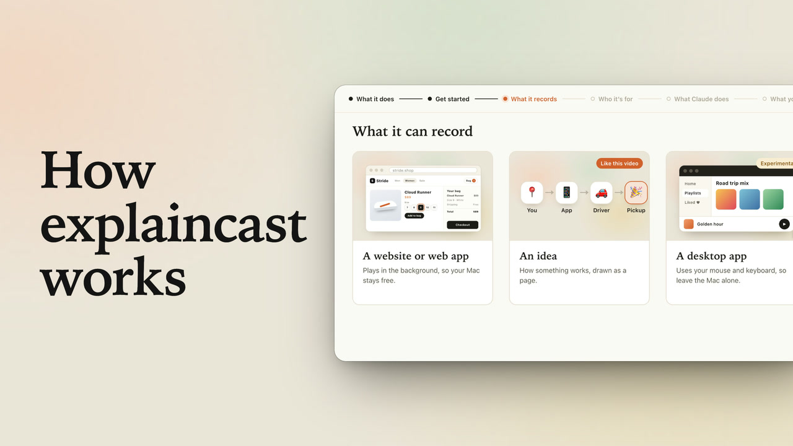

# explaincast

Give Claude Code a title and get a narrated explainer video back: an AI voice, clicks that land on the spoken words, zooms, captions and chapters.

Use it for walkthroughs, product demos, tutorials or explaining an idea, without recording your screen or your own voice. It records a website or web app, or an idea drawn as an HTML page. It can also record a desktop app, which is experimental for now.

[](https://youtu.be/inHJLU1rwVw)

*How explaincast works, made with explaincast itself. Click the image to watch it on YouTube.*

Another example: [starting and stopping a project in lpm](https://github.com/gug007/explaincast/releases/download/v0.1.0/demo.mp4) (1:20).

## Install

In Claude Code:

```
/plugin marketplace add gug007/explaincast
/plugin install explaincast@explaincast
```

You also need:

| Requirement | How to get it |
| --- | --- |
| macOS | Capture and the checks use its screen and text recognition APIs |
| Node.js | Tested on 24 |
| ffmpeg | `brew install ffmpeg` |
| Xcode Command Line Tools | `xcode-select --install` |
| Playwright | `npm install -g @playwright/cli` (tested on 0.1.17). Its Chromium downloads on the first run |
| An OpenAI API key, for the voice | See [Set up your OpenAI key](#set-up-your-openai-key) below |

Every run checks the machine first and tells you what is missing.

### Set up your OpenAI key

The voice and the word timing come from OpenAI, so explaincast needs your own API key. You do this once.

1. **Get a key.** Sign in at [platform.openai.com/api-keys](https://platform.openai.com/api-keys), click **Create new secret key** and copy it. It starts with `sk-`. The API is billed per use, so the account needs a payment method or credits under [Billing](https://platform.openai.com/settings/organization/billing).
2. **Save it in your Mac's Keychain.** Open Terminal, run this, paste the key when it asks and press Return. It asks twice, and nothing shows as you paste:

   ```
   security add-generic-password -s explaincast -a openai -U -w
   ```

3. **Check it worked.** This prints `saved` without showing the key:

   ```
   security find-generic-password -s explaincast -a openai >/dev/null && echo saved
   ```

Run step 2 again to replace the key, or remove it with `security delete-generic-password -s explaincast -a openai`.

If you'd rather use an environment variable, add `export OPENAI_API_KEY=sk-...` to your `~/.zshrc` and open a new terminal. When it is set, it is used instead of the Keychain.

Never paste the key into the Claude Code chat.

## Use

```
/explaincast How checkout works
```

Say what to explain. Claude picks how to record it, writes the script, proves every click in a free dry run, records the take and reviews it. Each video gets a folder in `~/Movies/explaincast/` (set `EXPLAINCAST_DIR` to move it), holding the MP4 and its `.srt` captions. Captions are not burned in.

To change something, ask Claude. It records again and voices only the lines you changed.

| You want a video of | Flag | What happens |
| --- | --- | --- |
| A website or web app | `--url <url>` | Runs headless, so you can keep using your Mac |
| An idea, architecture or process | `--file <page.html>` | Claude draws a page and drives it, also headless |
| A desktop app, terminal or editor | `--app "<name>"` | Experimental. Takes over your real pointer and keyboard, so leave the Mac alone. Needs `brew install cliclick` and Screen Recording and Accessibility permissions |

To choose for yourself, add a flag from these tables, as in `/explaincast How checkout works --url http://localhost:3000 --for client`. If another skill is also called `explaincast`, use the full name, `/explaincast:explaincast`.

Pick who it is for with `--for`:

| `--for` | Title cards | Music | Extras |
| --- | --- | --- | --- |
| `public` (default) | Yes | Yes | Chapter list, thumbnail, `youtube.txt` |
| `client` | Yes | No | Chapter list |
| `me` | No | No | Tighter pacing |

## Good to know

- **Your narration goes to OpenAI**, for speech and transcription, on your own key. The recording stays on your Mac. Check before narrating anything confidential.
- **Nothing is blurred.** The checks flag your own account details, email addresses and any terms you list in `hide`, but they know no other names. For client work, record demo or staging data.
- **Music:** public videos use "Vastness" by Andrew Ev from [Mixkit](https://mixkit.co/license/#musicFree), free for use in videos. Mixkit's terms forbid redistributing the file, so it isn't in this repo: the first public video downloads it. Set `"music": false` in `video.json` to go without.

## Development

```
node --test test/*.test.js
```

Every `video.json` field and beat call is in [reference/beats.md](skills/explaincast/reference/beats.md).

## License

[MIT](LICENSE)
